# zmk-config-glove43tb<!-- omit in toc -->

- Glove43tb用のZMKファームウェア

## Glove43tbとは<!-- omit in toc -->

- Xiao nRF52840（Xiao BLE）を採用した技適対応のワイヤレスキーボード
- Bluetooth接続（最大5台）とType-Cケーブルによる有線接続が可能
- `Cherry MXスイッチ`と`ロープロファイルスイッチ`（Choc V1, Choc V2_ガイドピン無し）に対応
- キースイッチのホットスワップにも対応
- 500mAhバッテリーを採用しながら薄型デザインを実現
- 左側キーボードにロータリーエンコーダを搭載


## スペック表<!-- omit in toc -->

| 項目 | 詳細 |
| -- | -- |
| ファームウェア | ZMK Firmware |
| 接続方式 | 有線接続（Type-C）<br>Bluetooth（最大5台） |
| 対応キースイッチ | ✅Choc V1<br>✅Choc V2（ガイドピン無し）<br>❌Choc V2（ガイドピン有り）<br>✅Lofree Ghost（Choc V2互換）<br>✅CherryMX |
| キーピッチ | 標準ピッチ（19mm） |
| バッテリー容量 | 500mAh |
| バッテリー駆動時間 | おおよそ1ヶ月ほど |
| ロータリーエンコーダ | ロープロファイル規格のエンコーダーを左側キーボードに配置 |

## キーボードレイアウト<!-- omit in toc -->



# Docs<!-- omit in toc -->

- [キーマップの変更方法](#キーマップの変更方法)
  - [ZMKファームウェアをビルドしてキーマップを変更する](#zmkファームウェアをビルドしてキーマップを変更する)
    - [0. 全体の流れ](#0-全体の流れ)
    - [1. GitHubアカウントを作成する](#1-githubアカウントを作成する)
    - [2. ZMKファームウェアのリポジトリをフォークする](#2-zmkファームウェアのリポジトリをフォークする)
    - [3. GitHub Actionsの有効化](#3-github-actionsの有効化)
    - [4. KeymapEditorとフォークしたリポジトリを連携する](#4-keymapeditorとフォークしたリポジトリを連携する)
    - [5. KeymapEditorでキー配列変更してファームウェアをビルドする](#5-keymapeditorでキー配列変更してファームウェアをビルドする)
    - [6. ファームウェアをキーボードに書き込む](#6-ファームウェアをキーボードに書き込む)
      - [6-1. 右側キーボードにファームウェアを書き込む](#6-1-右側キーボードにファームウェアを書き込む)
      - [6-2. 左側キーボードにファームウェアを書き込む](#6-2-左側キーボードにファームウェアを書き込む)
    - [7. 完了](#7-完了)
  - [ZMK Studioでキーマップを変更する](#zmk-studioでキーマップを変更する)
    - [1. `右側キーボード`とPCをType-Cケーブルで接続する](#1-右側キーボードとpcをtype-cケーブルで接続する)
    - [2. `ZMK Studio`にアクセス](#2-zmk-studioにアクセス)
    - [3. キーマップを変更するキーボードを選択](#3-キーマップを変更するキーボードを選択)
    - [4. キーマップを変更する](#4-キーマップを変更する)
    - [5. 完了](#5-完了)
- [Tips](#tips)
  - [左側キーボードでキー入力ができなくなった](#左側キーボードでキー入力ができなくなった)
  - [ロータリーエンコーダを取り外してキースイッチを取り付け可能](#ロータリーエンコーダを取り外してキースイッチを取り付け可能)
  - [現在のレイヤーをLEDの色で判別できるようにする](#現在のレイヤーをledの色で判別できるようにする)
  - [バッテリー残量をLEDで確認する](#バッテリー残量をledで確認する)
  - [接続状況を確認する](#接続状況を確認する)
  - [ロータリーエンコーダを取り外してキースイッチを取り付け可能](#ロータリーエンコーダを取り外してキースイッチを取り付け可能-1)
  - [キーボードがチャタリングするときの対処方法](#キーボードがチャタリングするときの対処方法)
  - [マウス感度の変更方法](#マウス感度の変更方法)
  - [マウススクロールの方向変更](#マウススクロールの方向変更)
  - [オートマウスレイヤーの無効化](#オートマウスレイヤーの無効化)
  - [オートマウスレイヤーのレイヤー変更](#オートマウスレイヤーのレイヤー変更)
  - [スクロール感度の変更方法](#スクロール感度の変更方法)
  - [スクロールレイヤーのレイヤー変更](#スクロールレイヤーのレイヤー変更)

## キーマップの変更方法

- ⚠️`ZMKファームウェアをビルドしてキーマップを変更する`と`ZMK Studioでキーマップを変更する`を併用することは非推奨です

  > ZMKファームウェアをビルドしてキーマップ変更したのに、ZMK Studioでのキーマップが優先されるケースがあるため
  >

- キーマップがうまく書き換えできなくなった場合は、[6. ファームウェアをキーボードに書き込む](#6-ファームウェアをキーボードに書き込む)で`settings_reset.uf2`を書き込む手順を含めて実行すると解消可能です

### ZMKファームウェアをビルドしてキーマップを変更する

#### 0. 全体の流れ

1. GitHubアカウントを作成する
2. ZMKファームウェアのリポジトリをフォークする
3. GitHub Actionsの有効化
4. KeymapEditorとフォークしたリポジトリを連携する
5. KeymapEditorでキー配列変更してファームウェアをビルドする
6. ファームウェアをキーボードに書き込む

#### 1. GitHubアカウントを作成する

- 以下のドキュメントを参考にアカウント作成すること

  > 公式ドキュメント:
  > https://docs.github.com/ja/get-started/start-your-journey/creating-an-account-on-github
  >
  > 参考ブログ:
  > https://zenn.dev/keison8864/articles/069d9be35b92c2
  >

#### 2. ZMKファームウェアのリポジトリをフォークする

- 以下のリポジトリをフォークする
  - https://github.com/keebkuro/zmk-config-glove43tb
- フォーク手順は以下の記事を参考に実施すること

  > 公式ドキュメント:
  > https://docs.github.com/ja/pull-requests/collaborating-with-pull-requests/working-with-forks/fork-a-repo
  >
  > 参考ブログ:
  > https://www.kagoya.jp/howto/rentalserver/webtrend/githubfork/
  >

#### 3. GitHub Actionsの有効化

- フォークしたリポジトリの「Actions」タブに移動し、「I understand my workflows, go ahead and enable them」をクリックし、github Actionsを有効化

  

#### 4. KeymapEditorとフォークしたリポジトリを連携する

- [KeymapEditor](https://nickcoutsos.github.io/keymap-editor/)にアクセス
- `GitHub` を選択

  

- 「Login with GitHub」からでログインし、「Authorize Keymap Editor」を選択
- 指示に従い、フォークしたリポジトリにKeymapEditorがアクセスできるように進める

#### 5. KeymapEditorでキー配列変更してファームウェアをビルドする

- [KeymapEditor](https://nickcoutsos.github.io/keymap-editor/)上でキーマップが表示されたら、好きにキーマップを編集する
- 画面左上の「Save」を押すと、編集したキーマップが適用されてGitHub Actionsが走り、自動的にビルドが開始します

  

- 「Save」の隣に表示される「Latest」をクリックするとGitHubに移動し、ビルドが完了するとファームウェアがダウンロードできるようになります。（ビルドには2～4分かかる場合があります。）

#### 6. ファームウェアをキーボードに書き込む

- ダウンロードしたzipファイルを解凍する

  

##### 6-1. 右側キーボードにファームウェアを書き込む

- `Reset Button`をダブルクリックしてブートモードに切り替える

  

- ブートモードのときにPCとキーボードをUSB接続すると`XIAO-SENSE`というリムーバルディスクが見えるようになります

  

- `XIAO-SENSE`に`glove43tb_R.uf2`ファイルをドラッグアンドドロップしてください
  - キーマップは右側（親機）に入っているため、キーマップの変更を反映するには右側への書き込みが必須です

  > 補足:
  > うまく動作しないときは、`settings_reset.uf2`を先に書き込んでリセットしてから、上述のファームウェア書き込みを実施すると解消できます

  > Macの場合:
  > Finderでコピーすると「デバイスがなくなったため、操作を完了できませんでした」等のエラーが出ることがありますが、書き込み完了と同時にキーボードが再起動するためです。`XIAO-SENSE`が消えたまま戻らなければ書き込みは完了しています
  > ターミナルで`cp -X ~/Downloads/firmware/glove43tb_R.uf2 /Volumes/XIAO-SENSE/`を実行しても書き込めます（`Input/output error`が出ても同様に問題ありません）
  > 書き込み後もキーマップが変わらない場合は、キーボードに入っているものと同じ古いファイルを書き込んでいるか、左右を取り違えている可能性があります
  >

##### 6-2. 左側キーボードにファームウェアを書き込む

- 右側キーボードと同じ手順で実施可能です
- 書き込むファームウェアは左側キーボード用のものに読み替えてください（`glove43tb_L.uf2`）

#### 7. 完了

- キーボードのスイッチを入れ直して完了
- キー入力が正常に行えることを確認してください

### ZMK Studioでキーマップを変更する

#### 1. `右側キーボード`とPCをType-Cケーブルで接続する

- 本キーボードは`右側キーボード`が親機になってますので、親機とPCをType-Cケーブルで有線接続すること

#### 2. `ZMK Studio`にアクセス

- Chromeなどの任意のブラウザで[ZMK Studio](https://zmk.studio/)にアクセス
  - https://zmk.studio/

#### 3. キーマップを変更するキーボードを選択

- `USB`を選択
  
- キーボードを選択するモーダルが表示されるので、`glove43tb (cu.usbmodem11301)`を選択してから`接続`をクリック
  

#### 4. キーマップを変更する

- 変更後に右上の保存アイコンをクリックすると、変更内容をキーボードに書き込めます
  

#### 5. 完了

- キーボードのスイッチを入れ直して完了
- キー入力が正常に行えることを確認してください

## Tips

### 左側キーボードでキー入力ができなくなった

- 左右キーボード間のペアリングが失敗している状態です
- [6. ファームウェアをキーボードに書き込む](#6-ファームウェアをキーボードに書き込む)で`settings_reset.uf2`を書き込む手順を含めて実行すると解消可能です
- `右側キーボード -> 左側キーボード`の順番で実行すると良いです

### ロータリーエンコーダを取り外してキースイッチを取り付け可能

- ロータリーエンコーダをハンダ付けしている箇所には、キーソケット（CherryMX, Choc V1/V2）もハンダ付け済みです
- はんだごてなどでロータリーエンコーダを取り外せばキースイッチを装着可能です

### 現在のレイヤーをLEDの色で判別できるようにする

- 利用中のレイヤーに応じてLEDの表示色を出し分けて判別しやすくする機能がある
- 本機能を`ON/OFF`したいときは以下のファイルを修正すること
  - [boards/shields/glove43tb/glove43tb_R.conf](boards/shields/glove43tb/glove43tb_R.conf)
  - `ON`にしたいとき:
    - `CONFIG_RGBLED_WIDGET_SHOW_LAYER_COLORS=y`
  - `OFF`にしたいとき:
    - `CONFIG_RGBLED_WIDGET_SHOW_LAYER_COLORS=n`
- 色を変更したい場合は`CONFIG_RGBLED_WIDGET_LAYER_*_COLOR`の値を変更する
  - [boards/shields/glove43tb/glove43tb_R.conf](boards/shields/glove43tb/glove43tb_R.conf)
  - 色と値の組み合わせ:

    | Color | Value |
    | -- | -- |
    | LED非表示 | 0 |
    | 🔴 | 1 |
    | 🟢 | 2 |
    | 🟡 | 3 |
    | 🔵 | 4 |
    | 🟣 | 5 |
    | 🔵（Cyan） | 6 |
    | ⚪（White） |  7 |

### バッテリー残量をLEDで確認する

- `&ind_bat`を割り当てたキーを入力することで確認可能

  > `Layer: 6`の左側キーボードに割当済み

- LED表示色とバッテリー残量

  | LED Color | バッテリー残量 |
  | -- | -- |
  | 🟢 | 60% |
  | 🟡 | 20% |
  | 🔴 | 10% |

- バッテリー残量の表示設定を変更したいときは以下のファイルを修正すること
  - [boards/shields/glove43tb/glove43tb_L.conf](boards/shields/glove43tb/glove43tb_L.conf)
  - [boards/shields/glove43tb/glove43tb_R.conf](boards/shields/glove43tb/glove43tb_R.conf)
  - `Green`として表示するバッテリー残量を変更したいとき:
    - `CONFIG_RGBLED_WIDGET_BATTERY_LEVEL_HIGH`の値を書き換える
  - `Yellow`として表示するバッテリー残量を変更したいとき:
    - `CONFIG_RGBLED_WIDGET_BATTERY_LEVEL_LOW`の値を書き換える
  - `Red`として表示するバッテリー残量を変更したいとき:
    - `CONFIG_RGBLED_WIDGET_BATTERY_LEVEL_CRITICAL`の値を書き換える

### 接続状況を確認する

- `&ind_con`を割り当てたキーを入力することで確認可能

  > `Layer: 6`の左側キーボードに割当済み

- LED表示色とBluetooth接続状況

  | LED Color | Bluetooth接続状況 |
  | -- | -- |
  | 🔵 | Bluetooth接続中 |
  | 🔴 | Bluetooth未接続 |

### ロータリーエンコーダで接続先を切り替える

- `Layer: 6`（左IMEキー長押し）のままロータリーエンコーダを回すと、接続先（BTプロファイル0〜4）を順番に切り替えられる
  - 音量を上げる方向に回すと次（`Y → U → I → O → P → Y`）、逆方向で前に戻る
  - 1クリックで2つ進まないよう、400ms以内の連続切替は無視する（[config/glove43tb.keymap](config/glove43tb.keymap)の`cooldown-ms`で調整可能）
  - 切り替えると右側のLEDが接続状況の色で点滅する
- 処理本体: [src/behaviors/behavior_bt_step.c](src/behaviors/behavior_bt_step.c)

### Windows / Mac の自動切替

- `Layer: 6`（左IMEキー長押し）の`Y U I O P`で接続先（BTプロファイル0〜4）を切り替えると、接続先に合わせて Mac 用レイヤー（7〜10）が自動で有効/無効になる
  - 初期設定: `Y U I`（プロファイル0〜2）= Windows、`O P`（プロファイル3,4）= Mac
  - Mac 用レイヤーでは`Ctrl+X/C/V`が`Cmd+X/C/V`、左下`Esc`長押しが`Cmd`、`Win`キーが`Ctrl`、スクショキーが`Cmd+Ctrl+Shift+4`、無変換コンボが`英数`になる
- Mac 扱いにするプロファイルを変更したいときは以下のファイルを修正すること
  - [boards/shields/glove43tb/glove43tb_R.conf](boards/shields/glove43tb/glove43tb_R.conf)
  - `CONFIG_GLOVE43TB_OS_LAYER_BLE_PROFILES`をビットマスクで指定する（例: プロファイル1と4なら`0x12`）
  - USB接続時も Mac 扱いにする場合は`CONFIG_GLOVE43TB_OS_LAYER_USB=y`
- 処理本体: [src/os_layer.c](src/os_layer.c)

### ロータリーエンコーダを取り外してキースイッチを取り付け可能

- ロータリーエンコーダをハンダ付けしている箇所には、キーソケット（CherryMX, Choc V1/V2）もハンダ付け済みです
- はんだごてなどでロータリーエンコーダを取り外せばキースイッチを装着可能です

### キーボードがチャタリングするときの対処方法

- 電波干渉によりチャタリング（想定外に何度も入力されてしまう）が生じていると考えられます
- 以下のファイルを修正することで、ソフトウェア側のデバウンスを調整することで対処可能です
  - [boards/shields/glove43tb/glove43tb_R.conf](boards/shields/glove43tb/glove43tb_R.conf)
  - [boards/shields/glove43tb/glove43tb_L.conf](boards/shields/glove43tb/glove43tb_L.conf)
- 上述のファイルに以下の内容を追記する

  ```text
  CONFIG_ZMK_KSCAN_DEBOUNCE_PRESS_MS=10
  CONFIG_ZMK_KSCAN_DEBOUNCE_RELEASE_MS=10
  ```

  - 値を大きくするほどチャタリングを防止できますが、キー入力時に遅延を感じるようになります

- 公式ドキュメント: https://zmk.dev/docs/features/debouncing

  > `CONFIG_ZMK_KSCAN_DEBOUNCE_PRESS_MS`: 未記載の場合は自動的に`5`として動作する
  >
  > `CONFIG_ZMK_KSCAN_DEBOUNCE_RELEASE_MS`: 未記載の場合は自動的に`5`として動作する
  >

- 参考例: https://x.com/search?q=CONFIG_ZMK_KSCAN_DEBOUNCE_RELEASE_MS

### マウス感度の変更方法

- トラックボールのマウス感度（CPI: Counts Per Inch）を変更したいときは以下のファイルを修正すること
  - [boards/shields/glove43tb/glove43tb_R.overlay](boards/shields/glove43tb/glove43tb_R.overlay)
- `cpi = <800>;`の値を変更する
  - 値を大きくするほど感度が上がります
  - 設定できる値は200〜3200の200刻みです（それ以外の値は200の倍数に切り捨てられます）
  - 例: `cpi = <1600>;` にすると感度が2倍になります

### トラックボールのブレ対策

- ブレ対策として以下の3つを設定済み
  1. 移動量の送信間隔: [boards/shields/glove43tb/glove43tb_R.conf](boards/shields/glove43tb/glove43tb_R.conf)の`CONFIG_PMW3610_REPORT_INTERVAL_MIN=12`
     - 0（毎回送信）だとBluetoothの送信間隔に収まらない分がまとめて届き、動かしている最中にカクつく・ブレる
     - USB接続だけで使う場合は`8`にするとより滑らかになる
  2. 触れただけのブレ対策: [boards/shields/glove43tb/glove43tb_R.overlay](boards/shields/glove43tb/glove43tb_R.overlay)の`zip_touch_filter`
     - `start-threshold`: 止まっている状態から、この量だけ動くまでポインタを動かさない（大きくするほどブレに強くなるが、動き出しが鈍くなる）
       - ここで無視された動きではオートマウスレイヤーも有効化されない
     - `idle-ms`: この時間（ミリ秒）トラックボールが動かなければ「止まっている」とみなす
  3. ゆっくり動かしているときのブレ対策: 同じく`zip_touch_filter`
     - `slow-gain-percent`: ゆっくり動かしたときの移動量の倍率（%）。小さくするほど細かいブレが減るが、細かい操作が遅くなる（`100`で無効）
     - `slow-speed` / `full-speed`: 倍率を`slow-gain-percent`から100%まで変化させる速さの範囲（カウント/16ms）。間はなめらかに変化し、縦横に同じ倍率をかけるので斜めの動きの向きも変わらない
- 速く動かしたときの速度は変わらない（速度を変えたいときは`cpi`を変更する）
- OS側のマウスの加速設定（Windowsの「ポインターの精度を高める」、Macの「軌跡の速さ」）とも組み合わさるため、遅く感じる場合は`slow-gain-percent`を上げる

### マウススクロールの方向変更

- トラックボールのスクロール方向を変更したいときは以下のファイルを修正すること
  - [boards/shields/glove43tb/glove43tb_R.overlay](boards/shields/glove43tb/glove43tb_R.overlay)
- `zip_scroll_transform`の設定を変更する
  - X軸を反転したい場合:
    - `&zip_scroll_transform INPUT_TRANSFORM_X_INVERT`
  - Y軸を反転したい場合:
    - `&zip_scroll_transform INPUT_TRANSFORM_Y_INVERT`
  - X軸とY軸の両方を反転したい場合:
    - `&zip_scroll_transform INPUT_TRANSFORM_X_INVERT INPUT_TRANSFORM_Y_INVERT`
  - 反転を無効化したい場合:
    - `&zip_scroll_transform`の行を削除する

### オートマウスレイヤーの無効化

- トラックボールを動かしたときに自動的にマウスレイヤーを有効化する機能を無効化したいときは以下のファイルを修正すること
  - [boards/shields/glove43tb/glove43tb_R.overlay](boards/shields/glove43tb/glove43tb_R.overlay)
- `input-processors = <&zip_touch_filter &zip_temp_layer 4 700>;`の`&zip_temp_layer 4 700`を削除する

### オートマウスレイヤーのレイヤー変更

- トラックボールを動かしたときに自動的に有効化されるレイヤーを変更したいときは以下のファイルを修正すること
  - [boards/shields/glove43tb/glove43tb_R.overlay](boards/shields/glove43tb/glove43tb_R.overlay)
- `input-processors = <&zip_touch_filter &zip_temp_layer 4 700>;`の`4`を変更する
  - 例: レイヤー2に変更したい場合: `input-processors = <&zip_touch_filter &zip_temp_layer 2 700>;`
  - 2つ目の数値（`700`）は、レイヤーが有効化される時間（ミリ秒）です

### スクロール感度の変更方法

- トラックボールのスクロール感度を変更したいときは以下のファイルを修正すること
  - [boards/shields/glove43tb/glove43tb_R.overlay](boards/shields/glove43tb/glove43tb_R.overlay)
- `zip_scroll_scaler 1 16`の2つ目の数値（`16`）を変更する
  - スクロール感度を2倍にする場合:
    - `zip_scroll_scaler 1 32`
  - スクロール感度を半分にする場合:
    - `zip_scroll_scaler 1 8`

### スクロールレイヤーのレイヤー変更

- トラックボールでスクロール操作を行うレイヤーを変更したいときは以下のファイルを修正すること
  - [boards/shields/glove43tb/glove43tb_R.overlay](boards/shields/glove43tb/glove43tb_R.overlay)
- `layers = <5>;`の`5`を変更する
  - 例: レイヤー2に変更したい場合: `layers = <2>;`
